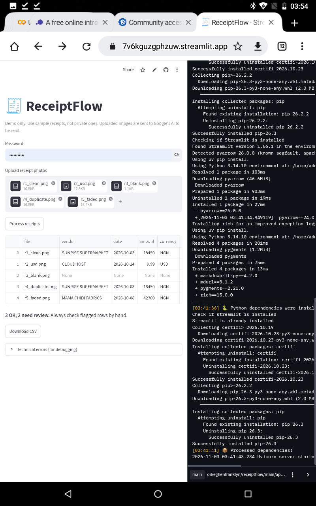
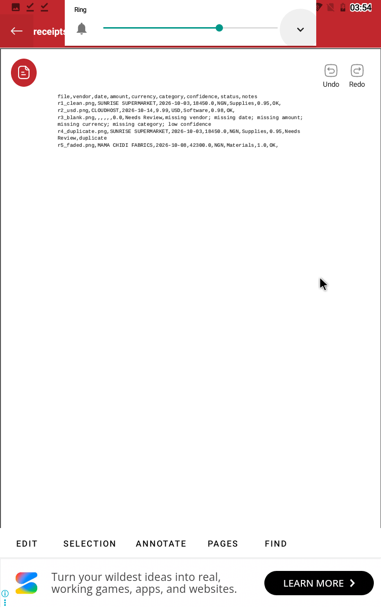
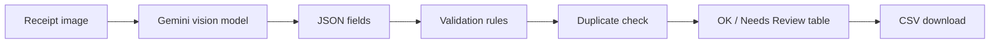

# ReceiptFlow

AI receipt organizer: reads receipt photos, extracts vendor, date, amount,
currency and category, and flags anything uncertain for human review.

**Status:** working prototype, tested on synthetic receipts only. Not
production-ready and not yet validated with real users.








## Problem
Small business owners and freelancers often keep receipts as photos and
type them into spreadsheets by hand, which is slow and error-prone.
*Assumption: not yet validated with real users.*

## How it works



**Design principle:** AI output is never trusted blindly. Deterministic
rules decide the final status.

## Safeguards
- Missing fields, invalid amounts and low model confidence (< 0.80) are flagged
- Dates in the future or older than one year are flagged
- Very small images (< 400 px) are flagged
- Duplicate receipts (same vendor, date, amount) are flagged
- API failures produce an empty row marked Needs Review, never fake data
- Requests are paced and fall back across models to respect free-tier limits

## Stack
Python, Streamlit, Google Gemini API, Pillow, pandas. Hosted on Streamlit
Community Cloud. Secrets live in the host's settings, never in the code.

## Files
- `app.py`: web interface
- `pipeline.py`: extraction, validation, duplicate detection, retry and fallback
- `requirements.txt`: dependencies

## Run locally
1. `pip install -r requirements.txt`
2. Create a file `.streamlit/secrets.toml` containing:
   ```
   GEMINI_API_KEY = "your-key-here"
   ```
   (This file is in `.gitignore`. Never commit it.)
3. `streamlit run app.py`

Optional: add `APP_PASSWORD = "..."` to the same file to enable the
password gate.

## Testing (all synthetic, computer-generated receipts)
| Test set | Result |
|---|---|
| 5 baseline receipts | All correct; blank and duplicate flagged |
| 6 hard cases (rotated, blurred, ambiguous date, VAT, EUR, non-receipt) | 5 correct, 1 non-receipt flagged, 0 wrong-but-OK |
| 4 stress images (tilt, noise, tiny, dark) | 3 correct; 1 misread year marked OK |
| Fix: date and image-size rules | Rule-tested on stored values |
| Deployed app, 5 receipts | All matched expected results |

**Key finding:** a heavily compressed image made the model read 2026 as
2025 with 0.95 confidence. Model confidence is not accuracy, so I added
deterministic date and image-size checks.

## Limitations
- Tested only on synthetic receipts, not real photos
- Not validated with real users
- Free-tier AI limits (5 requests/min per model) slow batch processing
- A plausible misread in a large image can still pass the checks
- Uploaded images are sent to Google's AI, so don't use private receipts

## Challenges solved
- Retired model names (404): fallback model list
- Busy servers (503) and quota limits (429): retries, pacing, fallback
- Case-sensitive file names broke deployment
- Empty rows wrongly flagged as duplicates

## Next
Real-receipt testing, user feedback, Google Sheets export, WhatsApp upload.
